# Distribuições escolhidas para o Arena

Parametrização do Arena: `EXPO(média)`, `GAMM(escala β, forma α)`, `ERLA(média de cada fase, k)`, `WEIB(escala β, forma α)`, `LOGN(média, desvio)` (da própria variável, não do log), `NORM(média, desvio)`, `TRIA(mín, moda, máx)`, `BETA(β, α)` em [0,1] reescalada, `CONT(prob. acumulada, valor, ...)` empírica.

| Variável | N | Média obs. | Distribuição | Expressão Arena | Erro quadr. | Qui² p | KS p |
|---|---|---|---|---|---|---|---|
| CALADO | 2141 | 11.627 m | Empírica (CONT) | `CONT(0.00, 6.62, 0.10, 7.42, 0.20, 8.62, 0.30, 9.50, 0.40, 9.88, 0.50, 11.40, 0.60, 12.15, 0.70, 14.02, 0.80, 15.00, 0.90, 16.00, 1.00, 19.00)` | 0.02658 | 0 | 6.2e-12 |
| ESLORA | 2141 | 225.899 m | Empírica (CONT) | `CONT(0.00, 99.95, 0.10, 140.67, 0.20, 151.00, 0.30, 159.00, 0.40, 172.00, 0.50, 195.00, 0.60, 237.00, 0.70, 272.30, 0.80, 300.07, 0.90, 364.15, 1.00, 400.00)` | 0.02980 | 0 | 3.99e-28 |
| MANOBRA_ENTRADA | 2141 | 0.750 h | TRIA | `TRIA(0.366, 0.613, 1.307)` | 0.00099 | 2.22e-07 | 0.00371 |
| MANOBRA_SAIDA | 2141 | 0.584 h | TRIA | `TRIA(0.245, 0.476, 1.053)` | 0.00128 | 7.89e-12 | 0.00397 |
| OPER_APM | 652 | 15.461 h | LOGN | `LOGN(15.414, 8.478)` | 0.00195 | 0.000127 | 0.131 |
| OPER_GERAL | 2110 | 17.997 h | LOGN | `1.700 + LOGN(16.479, 12.700)` | 0.00061 | 2.86e-06 | 0.264 |
| OPER_PNOU | 194 | 22.369 h | Empírica (CONT) | `CONT(0.00, 1.92, 0.10, 8.01, 0.20, 10.15, 0.30, 12.22, 0.40, 14.23, 0.50, 17.21, 0.60, 20.72, 0.70, 28.46, 0.80, 39.07, 0.90, 43.03, 1.00, 68.53)` | 0.01448 | 8.17e-14 | 0.0255 |
| OPER_TCAT | 1264 | 18.634 h | LOGN | `2.000 + LOGN(16.997, 13.999)` | 0.00070 | 0.0333 | 0.731 |
| PERM_GERAL | 2110 | 19.325 h | LOGN | `2.700 + LOGN(16.810, 12.867)` | 0.00059 | 9.73e-07 | 0.242 |
| TEC_APM | 656 | 13.283 h | EXPO | `EXPO(13.283)` | 0.00532 | 9.03e-05 | 0.00149 |
| TEC_GERAL | 2140 | 4.082 h | EXPO | `EXPO(4.082)` | 0.00087 | 0.0862 | 0.0543 |
| TEC_PNOU | 193 | 45.064 h | ERLA | `ERLA(22.532, 2)` | 0.00458 | 0.387 | 0.4 |
| TEC_TCAT | 1289 | 6.772 h | WEIB | `WEIB(7.143, 1.158)` | 0.00033 | 0.261 | 0.778 |

## Justificativas

### CALADO

Variável física limitada pela profundidade do canal/cais; mesma lógica da eslora. Nenhuma paramétrica reproduz a forma (melhor: BETA, qui² p = 0); usa-se a distribuição EMPÍRICA contínua construída pelos decis observados. Alternativa paramétrica: 6.608 + 12.405 * BETA(1.088, 1.617). Com n grande os testes de aderência rejeitam até desvios pequenos; por isso a decisão também considera o erro quadrático, o Q-Q plot e a coerência teórica.

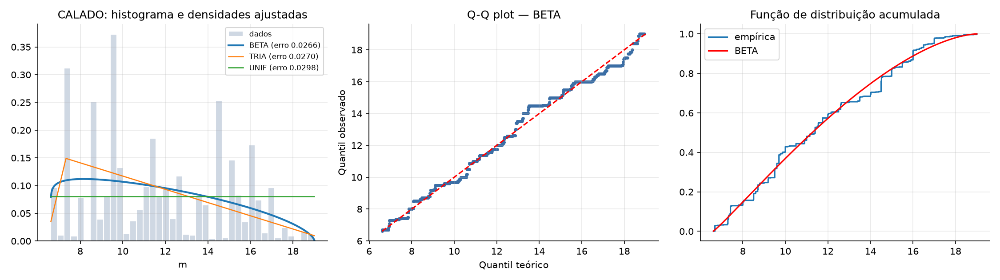

### ESLORA

Variável limitada (navios entre ~100 e 400 m) e com mais de uma moda (feeders pequenos e navios oceânicos grandes). Distribuições limitadas (Beta/Triangular) são as candidatas teóricas; se nenhuma reproduzir a forma, a empírica contínua (CONT) é a escolha mais fiel. Nenhuma paramétrica reproduz a forma (melhor: TRIA, qui² p = 0); usa-se a distribuição EMPÍRICA contínua construída pelos decis observados. Alternativa paramétrica: TRIA(99.728, 141.580, 435.632). Com n grande os testes de aderência rejeitam até desvios pequenos; por isso a decisão também considera o erro quadrático, o Q-Q plot e a coerência teórica.

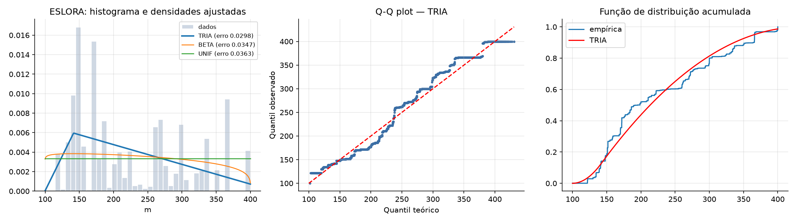

### MANOBRA_ENTRADA

Dado SINTÉTICO (ver 01_dados/log_limpeza.md). Tempo de tarefa com mínimo e máximo práticos; Triangular/Beta são clássicas para tempos de atividade estimados por especialistas. Menor erro quadrático entre as famílias teoricamente adequadas (0.00099); AIC = -1402.9. Com n grande os testes de aderência rejeitam até desvios pequenos; por isso a decisão também considera o erro quadrático, o Q-Q plot e a coerência teórica.

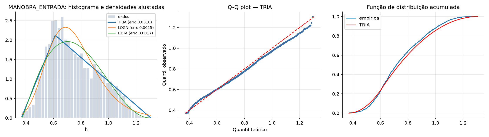

### MANOBRA_SAIDA

Dado SINTÉTICO (ver 01_dados/log_limpeza.md). Tempo de tarefa com mínimo e máximo práticos; Triangular/Beta são clássicas para tempos de atividade estimados por especialistas. Menor erro quadrático entre as famílias teoricamente adequadas (0.00128); AIC = -2042.9. Com n grande os testes de aderência rejeitam até desvios pequenos; por isso a decisão também considera o erro quadrático, o Q-Q plot e a coerência teórica.

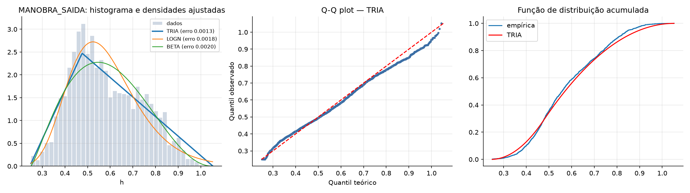

### OPER_APM

Tempo de serviço positivo, com mínimo físico (sempre há algumas horas de carga/descarga) e cauda à direita (navios com muitos contêineres). Famílias adequadas: Gama/Erlang, Weibull e Lognormal com deslocamento (offset). Normal é inadequada (assimetria) e Exponencial supõe moda em 0. Menor erro quadrático entre as famílias teoricamente adequadas (0.00195); AIC = 4381.2. Com n grande os testes de aderência rejeitam até desvios pequenos; por isso a decisão também considera o erro quadrático, o Q-Q plot e a coerência teórica.

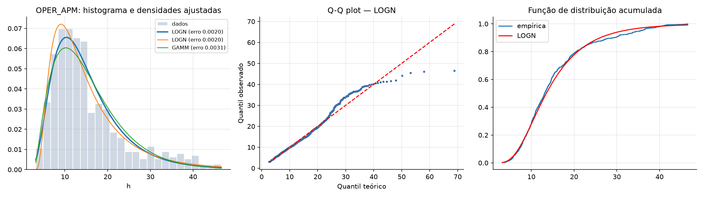

### OPER_GERAL

Tempo de serviço positivo, com mínimo físico (sempre há algumas horas de carga/descarga) e cauda à direita (navios com muitos contêineres). Famílias adequadas: Gama/Erlang, Weibull e Lognormal com deslocamento (offset). Normal é inadequada (assimetria) e Exponencial supõe moda em 0. Menor erro quadrático entre as famílias teoricamente adequadas (0.00061); AIC = 15224.8. Com n grande os testes de aderência rejeitam até desvios pequenos; por isso a decisão também considera o erro quadrático, o Q-Q plot e a coerência teórica.

### OPER_PNOU

Tempo de serviço positivo, com mínimo físico (sempre há algumas horas de carga/descarga) e cauda à direita (navios com muitos contêineres). Famílias adequadas: Gama/Erlang, Weibull e Lognormal com deslocamento (offset). Normal é inadequada (assimetria) e Exponencial supõe moda em 0. Nenhuma paramétrica reproduz a forma (melhor: LOGN, qui² p = 8.2e-14); usa-se a distribuição EMPÍRICA contínua construída pelos decis observados. Alternativa paramétrica: 1.700 + LOGN(21.687, 20.508).

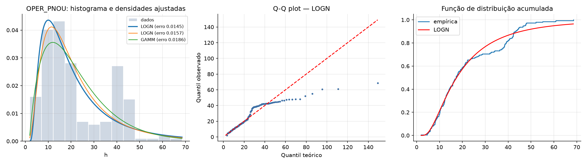

### OPER_TCAT

Tempo de serviço positivo, com mínimo físico (sempre há algumas horas de carga/descarga) e cauda à direita (navios com muitos contêineres). Famílias adequadas: Gama/Erlang, Weibull e Lognormal com deslocamento (offset). Normal é inadequada (assimetria) e Exponencial supõe moda em 0. Menor erro quadrático entre as famílias teoricamente adequadas (0.00070); AIC = 9268.5. Com n grande os testes de aderência rejeitam até desvios pequenos; por isso a decisão também considera o erro quadrático, o Q-Q plot e a coerência teórica.

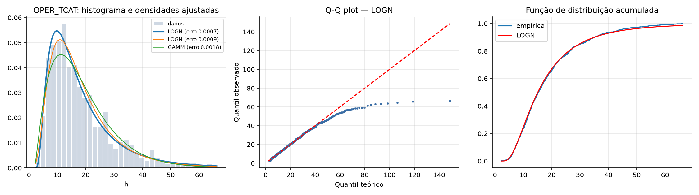

### PERM_GERAL

Mesma justificativa da operação no cais (é a operação + manobras). Usada como referência de validação. Menor erro quadrático entre as famílias teoricamente adequadas (0.00059); AIC = 15296.4. Com n grande os testes de aderência rejeitam até desvios pequenos; por isso a decisão também considera o erro quadrático, o Q-Q plot e a coerência teórica.

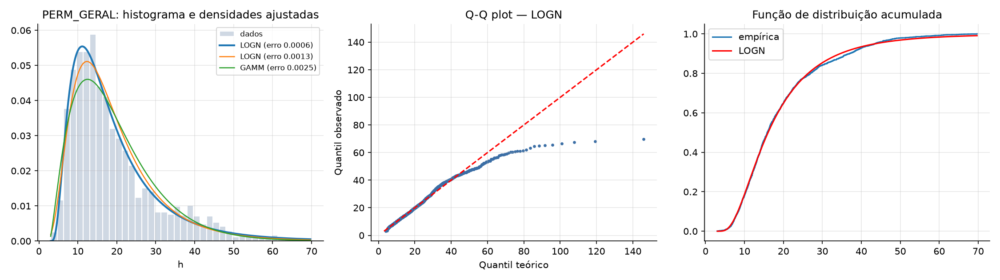

### TEC_APM

Tempo entre chegadas de navios vindos de portos e armadores diferentes, de forma independente (autocorrelação ≈ 0). A teoria de filas indica processo de Poisson → Exponencial, cujo CV = 1. CV observado = 0.91 (≈1); a Exponencial tem erro próximo do melhor. WEIB tem erro um pouco menor (0.00269 vs 0.00532), mas com forma ≈ 1 ela é praticamente uma Exponencial; preferida por coerência teórica e parcimônia (1 parâmetro, fácil de alterar nos cenários de demanda). Com n grande os testes de aderência rejeitam até desvios pequenos; por isso a decisão também considera o erro quadrático, o Q-Q plot e a coerência teórica.

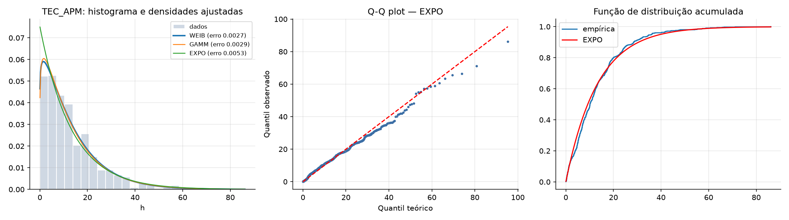

### TEC_GERAL

Tempo entre chegadas de navios vindos de portos e armadores diferentes, de forma independente (autocorrelação ≈ 0). A teoria de filas indica processo de Poisson → Exponencial, cujo CV = 1. CV observado = 0.97 (≈1); a Exponencial não é rejeitada a 5% (KS p = 0.054; Qui² p = 0.086). WEIB tem erro um pouco menor (0.00015 vs 0.00087), mas com forma ≈ 1 ela é praticamente uma Exponencial; preferida por coerência teórica e parcimônia (1 parâmetro, fácil de alterar nos cenários de demanda). Com n grande os testes de aderência rejeitam até desvios pequenos; por isso a decisão também considera o erro quadrático, o Q-Q plot e a coerência teórica.

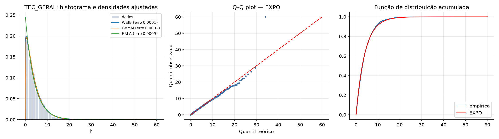

### TEC_PNOU

Tempo entre chegadas de navios vindos de portos e armadores diferentes, de forma independente (autocorrelação ≈ 0). A teoria de filas indica processo de Poisson → Exponencial, cujo CV = 1. CV observado = 0.64 (≠1): chegadas mais regulares que Poisson, típico de linhas regulares com janelas de atracação programadas; por isso ERLA (forma > 1) representa melhor que a Exponencial.

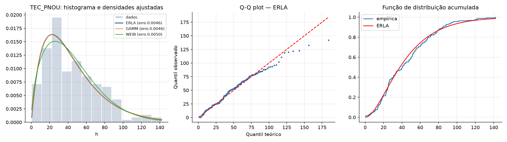

### TEC_TCAT

Tempo entre chegadas de navios vindos de portos e armadores diferentes, de forma independente (autocorrelação ≈ 0). A teoria de filas indica processo de Poisson → Exponencial, cujo CV = 1. CV observado = 0.93, próximo de 1, mas a Exponencial é rejeitada (KS p = 0.00014; Qui² p = 4.52e-05) e tem erro 9.9× maior. WEIB (forma levemente > 1) indica chegadas um pouco mais regulares que Poisson, coerente com escalas de linhas regulares programadas. Alternativa simplificada aceitável: EXPO(6.772). Com n grande os testes de aderência rejeitam até desvios pequenos; por isso a decisão também considera o erro quadrático, o Q-Q plot e a coerência teórica.

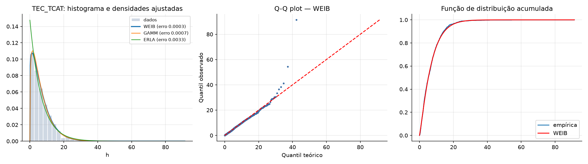
