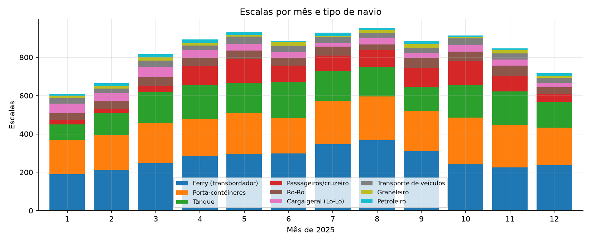
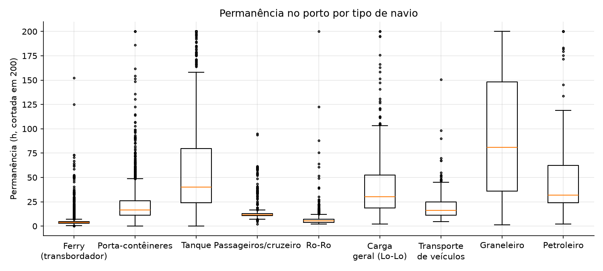

# Panorama do Porto de Barcelona — 2025

10038 escalas válidas em 364 dias (27.5 navios/dia).

## Por tipo de navio

| Tipo de navio          |   Escalas |   % do porto |   Chegadas/dia |   TEC médio (h) |   CV do TEC |   Permanência média (h) |   Permanência mediana (h) |   Desvio perm. (h) |   Atípicos perm. (3×IQR) |   Eslora média (m) | Dist. sugerida TEC   | Dist. sugerida permanência   |
|:-----------------------|----------:|-------------:|---------------:|----------------:|------------:|------------------------:|--------------------------:|-------------------:|-------------------------:|-------------------:|:---------------------|:-----------------------------|
| Ferry (transbordador)  |      3261 |        32.49 |           8.95 |            2.68 |        1.62 |                    3.46 |                      3.37 |               1.12 |                      524 |             180.54 | LOGN(3.99, 21.25)    | GAMM(0.38, 9.020)            |
| Porta-contêineres      |      2482 |        24.73 |           6.81 |            3.52 |        1    |                   20.11 |                     16.32 |              12.4  |                       52 |             218.46 | WEIB(3.58, 1.044)    | LOGN(20.30, 13.52)           |
| Tanque                 |      1795 |        17.88 |           4.93 |            4.86 |        1.09 |                   56.55 |                     39.56 |              46.12 |                       29 |             147.49 | WEIB(4.74, 0.950)    | LOGN(59.70, 63.18)           |
| Passageiros/cruzeiro   |       896 |         8.93 |           2.46 |            9.68 |        1.4  |                   11.4  |                     11.18 |               1.81 |                       93 |             285.21 | LOGN(18.26, 143.31)  | GAMM(0.32, 35.863)           |
| Ro-Ro                  |       519 |         5.17 |           1.42 |           16.75 |        0.8  |                    5.94 |                      5.08 |               2.96 |                       33 |             228.85 | WEIB(17.88, 1.236)   | LOGN(5.89, 2.61)             |
| Carga geral (Lo-Lo)    |       416 |         4.14 |           1.14 |           20.95 |        1.17 |                   38.49 |                     29.47 |              28.92 |                        9 |             116.85 | GAMM(25.24, 0.830)   | LOGN(39.51, 36.14)           |
| Transporte de veículos |       360 |         3.59 |           0.99 |           24.22 |        0.89 |                   18.92 |                     16.13 |              10.09 |                        6 |             177.66 | EXPO(24.22)          | LOGN(18.90, 10.24)           |
| Graneleiro             |       158 |         1.57 |           0.43 |           53.93 |        0.95 |                  112.78 |                     80.34 |             103.42 |                        2 |             188.09 | EXPO(53.93)          | LOGN(124.60, 178.03)         |
| Petroleiro             |       151 |         1.5  |           0.41 |           57.86 |        1.31 |                   42.33 |                     29.5  |              32.41 |                       12 |             219.69 | WEIB(52.36, 0.839)   | LOGN(42.26, 32.40)           |

## Top 15 terminais

| TERMINALNOM                     |   Escalas |     % |
|:--------------------------------|----------:|------:|
| TERMINAL F2                     |      1674 | 16.68 |
| TERMINAL CATALUNYA SA           |      1327 | 13.22 |
| APM TERMINALS BARCELONA, S.L.U. |       673 |  6.7  |
| TERMINAL F1                     |       661 |  6.58 |
| GRIMALDI TERMINAL BARCELONA SL  |       463 |  4.61 |
| LEPANT/TRUCK CENTER             |       306 |  3.05 |
| TERMINAL F3                     |       283 |  2.82 |
| TERMINAL F4                     |       278 |  2.77 |
| TERMINAL PORT NOU SA            |       257 |  2.56 |
| AUTOTERMINAL SA                 |       231 |  2.3  |
| TRADEBE PORT SERVICES SL        |       202 |  2.01 |
| MEROIL SA                       |       197 |  1.96 |
| TEPSA IBERIA SLU                |       186 |  1.85 |
| ADOSSAT/TERMINAL H              |       181 |  1.8  |
| ADOSSAT/TERMINAL E              |       166 |  1.65 |

## Top 15 origens

| PORTORIGENNOM     |   Escalas |     % |
|:------------------|----------:|------:|
| Palma de Mallorca |      1163 | 11.59 |
| Valencia          |       910 |  9.07 |
| Alcudia           |       669 |  6.66 |
| Ibiza             |       537 |  5.35 |
| Marseille         |       378 |  3.77 |
| Genoa             |       360 |  3.59 |
| Mahon Menorca     |       313 |  3.12 |
| Fos-sur-Mer       |       263 |  2.62 |
| Savona            |       255 |  2.54 |
| Algeciras         |       226 |  2.25 |
| Civitavecchia     |       205 |  2.04 |
| Sete              |       204 |  2.03 |
| Livorno           |       190 |  1.89 |
| Tarragona         |       179 |  1.78 |
| Sagunto           |       178 |  1.77 |

## Top 15 bandeiras

| VAIXELLBANDERANOM   |   Escalas |     % |
|:--------------------|----------:|------:|
| Itàlia              |      1894 | 18.87 |
| Malta               |      1356 | 13.51 |
| Xipre               |      1284 | 12.79 |
| Espanya             |      1034 | 10.3  |
| Libèria             |       903 |  9    |
| Portugal            |       790 |  7.87 |
| Panamà              |       456 |  4.54 |
| Illes Marshall      |       437 |  4.35 |
| Bahames             |       275 |  2.74 |
| Singapur            |       185 |  1.84 |
| Països Baixos       |       177 |  1.76 |
| Hong Kong           |       165 |  1.64 |
| Dinamarca           |       132 |  1.32 |
| Grècia              |        86 |  0.86 |
| Noruega             |        82 |  0.82 |

## Top 15 consignatarios

| CONSIGNATARI                           |   Escalas |     % |
|:---------------------------------------|----------:|------:|
| BALEARIA EUROLINEAS MARITIMAS SA       |      1350 | 13.45 |
| GRIMALDI LOGISTICA ESPAÑA SL           |      1315 | 13.1  |
| TRANSCOMA BALEARES SA                  |      1013 | 10.09 |
| MEDITERRANEAN SHIPPING COM ESPAÑA SLU  |       829 |  8.26 |
| ALFASHIP MARITIME SERVICES SL          |       772 |  7.69 |
| IBERICA MARITIMA BARCELONA SA          |       691 |  6.88 |
| NOATUM MARITIME SPAIN SAU              |       641 |  6.39 |
| A PEREZ Y CIA SL                       |       373 |  3.72 |
| CMA CGM IBERICA SAU                    |       306 |  3.05 |
| BERGE MARITIMA SL                      |       230 |  2.29 |
| HAPAG LLOYD SPAIN SL                   |       181 |  1.8  |
| NEPTUNE BARCELONA SA                   |       180 |  1.79 |
| INTERCRUISES PORT OPERATIONS SPAIN SLU |       162 |  1.61 |
| ERSHIP SA                              |       157 |  1.56 |
| SOLUCIONES INTEGRALES MARITIMAS SLU    |       149 |  1.48 |
