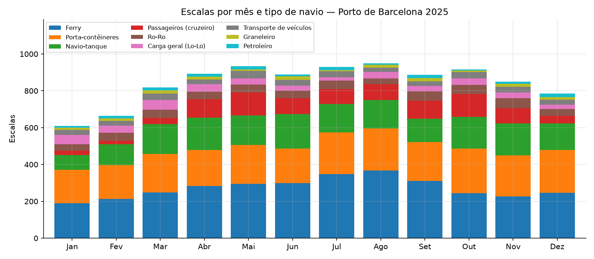
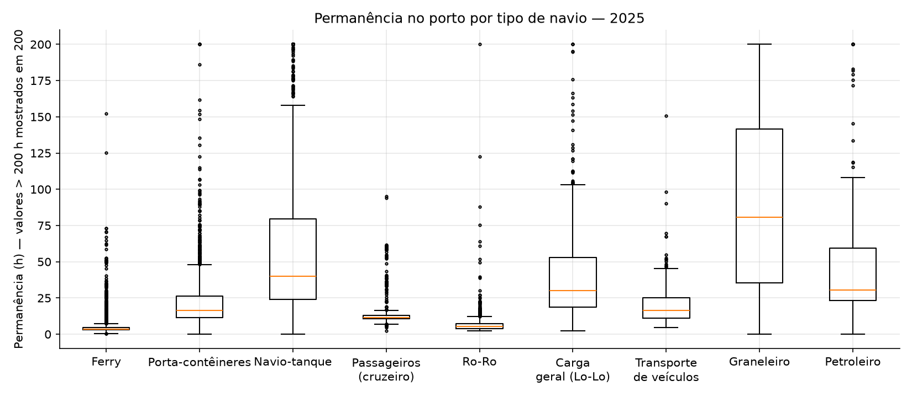

# Panorama do Porto de Barcelona por tipo de navio — 2025

> Gerado automaticamente por `analise/scripts/2_panorama_porto.py` a partir de
> `1_dados_limpos/escalas_porto_limpas.csv` (10,122 escalas, 27.7 navios/dia).

## Para que serve

Contextualiza o recorte do modelo na introdução do relatório: mostra onde os porta-contêineres se encaixam no
movimento total do porto e por que foram escolhidos (é o 2º maior fluxo, com permanência longa e concentrada
em poucos terminais, o que favorece a formação de filas por berço).

## Resumo por tipo de navio

| Tipo de navio          |   Escalas |   % do porto |   Chegadas/dia |   Intervalo médio entre chegadas (h) |   CV do intervalo |   Permanência média (h) |   Permanência mediana (h) |   Desvio da permanência (h) |   Atípicos extremos |   Comprimento médio (m) | Principal terminal                   | Distribuição sugerida — intervalo   | Distribuição sugerida — permanência   |
|:-----------------------|----------:|-------------:|---------------:|-------------------------------------:|------------------:|------------------------:|--------------------------:|----------------------------:|--------------------:|------------------------:|:-------------------------------------|:------------------------------------|:--------------------------------------|
| Ferry                  |      3270 |        32.31 |           8.96 |                                 2.68 |              1.62 |                    3.46 |                      3.37 |                        1.12 |                 533 |                  180.54 | TERMINAL F2 (51%)                    | LOGN(3.99, 21.26)                   | GAMM(0.38, 9.020)                     |
| Porta-contêineres      |      2531 |        25    |           6.93 |                                 3.46 |              0.98 |                   20.09 |                     16.18 |                       12.48 |                  54 |                  218.64 | TERMINAL CATALUNYA SA (52%)          | GAMM(3.27, 1.058)                   | LOGN(20.63, 14.79)                    |
| Navio-tanque           |      1809 |        17.87 |           4.96 |                                 4.84 |              1.09 |                   56.31 |                     39.33 |                       46.08 |                  31 |                  147.43 | TRADEBE PORT SERVICES SL (11%)       | WEIB(4.72, 0.945)                   | LOGN(61.65, 71.13)                    |
| Passageiros (cruzeiro) |       896 |         8.85 |           2.45 |                                 9.68 |              1.4  |                   11.4  |                     11.18 |                        1.81 |                  93 |                  285.21 | ADOSSAT/TERMINAL H (20%)             | LOGN(18.26, 143.31)                 | GAMM(0.32, 35.863)                    |
| Ro-Ro                  |       519 |         5.13 |           1.42 |                                16.75 |              0.8  |                    5.94 |                      5.08 |                        2.96 |                  33 |                  228.85 | GRIMALDI TERMINAL BARCELONA SL (79%) | WEIB(17.88, 1.236)                  | LOGN(5.89, 2.61)                      |
| Carga geral (Lo-Lo)    |       417 |         4.12 |           1.14 |                                20.9  |              1.17 |                   38.78 |                     29.48 |                       29.45 |                   9 |                  116.83 | TRAFICO DE MERCANCIAS SA (22%)       | GAMM(25.08, 0.833)                  | LOGN(39.77, 36.60)                    |
| Transporte de veículos |       361 |         3.57 |           0.99 |                                24.19 |              0.89 |                   19.02 |                     16.13 |                       10.22 |                   6 |                  177.64 | AUTOTERMINAL SA (55%)                | EXPO(24.19)                         | LOGN(18.99, 10.36)                    |
| Graneleiro             |       162 |         1.6  |           0.44 |                                54.27 |              0.97 |                  109.18 |                     80.17 |                       98.92 |                   3 |                  188.5  | ERGRANSA SA (24%)                    | EXPO(54.27)                         | GAMM(93.92, 1.162)                    |
| Petroleiro             |       157 |         1.55 |           0.43 |                                56.05 |              1.33 |                   39.52 |                     28.5  |                       28.4  |                  14 |                  220.18 | ENAGAS TRANSPORTE SAU (29%)          | WEIB(49.09, 0.796)                  | GAMM(21.50, 1.838)                    |

### O que significa cada coluna

| Coluna | Significado |
|---|---|
| Tipo de navio | Classificação Lloyd's do campo `VAIXELLTIPUS`, traduzida (ver tabela de tipos abaixo) |
| Escalas | Nº de escalas (visitas ao porto) em 2025 |
| % do porto | Participação no total de escalas do porto |
| Chegadas/dia | Escalas ÷ 365: ritmo médio de chegada |
| Intervalo médio entre chegadas (h) | Tempo médio entre dois navios consecutivos do mesmo tipo |
| CV do intervalo | Coeficiente de variação (desvio ÷ média). **≈ 1** indica chegadas aleatórias (Poisson/Exponencial); **< 1**, chegadas mais regulares (linhas programadas); **> 1**, chegadas em rajadas (ex.: ferries que chegam juntos de manhã) |
| Permanência média / mediana (h) | Tempo no porto (ETD − ETA), **sem os atípicos extremos**. Média bem maior que a mediana indica cauda longa (alguns navios ficam muito tempo) |
| Desvio da permanência (h) | Dispersão da permanência (sem extremos) |
| Atípicos extremos | Escalas com permanência > Q3 + 3×IQR do próprio tipo (ex.: reparos, paradas longas); excluídas das 3 colunas anteriores |
| Comprimento médio (m) | Média da `ESLORA_METRES` |
| Principal terminal | Terminal que mais recebe esse tipo e a % das escalas do tipo que vão para ele |
| Distribuição sugerida — intervalo / permanência | Melhor ajuste automático (menor erro quadrático) entre EXPO, GAMM, WEIB e LOGN, na sintaxe do Arena. **É ponto de partida, não escolha final**: para o tipo modelado, a escolha é feita com teste de aderência e justificativa (ver `3_graficos/GRAFICOS.md`) |

Sintaxe do Arena: `EXPO(média)`, `GAMM(escala, forma)`, `WEIB(escala, forma)`, `LOGN(média, desvio)`.

## Tipos de navio (valores de `VAIXELLTIPUS`)

| Valor no CSV (catalão) | Tradução | O que é |
|---|---|---|
| Transbordadors | Ferry | Linhas regulares de passageiros + veículos (Baleares, Itália, Norte da África). Permanência curta (~3 h) |
| Portacontenidors | Porta-contêineres | Carga em contêineres movimentada por guindastes de cais. **Recorte do modelo** |
| Tancs | Navio-tanque | Produtos líquidos (químicos, combustíveis refinados) |
| Passatge | Passageiros (cruzeiro) | Navios de cruzeiro: chegam de manhã e saem à noite (~11 h) |
| Ro-Ro | Ro-Ro | *Roll-on/roll-off*: carga sobre rodas (caminhões, semirreboques) entra/sai por rampa |
| Car-carrier | Transporte de veículos | Navios-garagem para automóveis novos |
| Càrrega (Lo-Lo) | Carga geral (Lo-Lo) | *Lift-on/lift-off*: carga geral içada por guindaste |
| Petroliers | Petroleiro | Petróleo bruto e derivados |
| Granelers | Graneleiro | Granéis sólidos (grãos, cimento, minério). Maior permanência média |

## Gráficos

**Escalas por mês e tipo:** cada barra é um mês, dividida por tipo de navio. Mostra o volume total do porto e a
sazonalidade: os ferries têm pico no verão (julho–agosto) e os cruzeiros se concentram de abril a outubro, com
picos em maio e outubro. Os porta-contêineres variam menos de um mês para outro no porto inteiro.

**Permanência por tipo:** boxplot (caixa = 50% centrais, linha = mediana, pontos = atípicos). Mostra a
diferença de "tempo de serviço" entre tipos: ferries e Ro-Ro ficam poucas horas; graneleiros e tanques, dias.

## Top 15 — Terminais

| Terminais                       |   Escalas |   % do porto |
|:--------------------------------|----------:|-------------:|
| TERMINAL F2                     |      1678 |        16.58 |
| (sem terminal)                  |      1427 |        14.1  |
| TERMINAL CATALUNYA SA           |      1365 |        13.49 |
| APM TERMINALS BARCELONA, S.L.U. |       677 |         6.69 |
| TERMINAL F1                     |       664 |         6.56 |
| GRIMALDI TERMINAL BARCELONA SL  |       463 |         4.57 |
| LEPANT/TRUCK CENTER             |       307 |         3.03 |
| TERMINAL F3                     |       284 |         2.81 |
| TERMINAL F4                     |       278 |         2.75 |
| TERMINAL PORT NOU SA            |       259 |         2.56 |
| AUTOTERMINAL SA                 |       231 |         2.28 |
| TRADEBE PORT SERVICES SL        |       203 |         2.01 |
| MEROIL SA                       |       199 |         1.97 |
| TEPSA IBERIA SLU                |       186 |         1.84 |
| ADOSSAT/TERMINAL H              |       181 |         1.79 |

## Top 15 — Portos de origem

| Portos de origem   |   Escalas |   % do porto |
|:-------------------|----------:|-------------:|
| Palma de Mallorca  |      1166 |        11.52 |
| Valencia           |       918 |         9.07 |
| Alcudia            |       671 |         6.63 |
| Ibiza              |       539 |         5.33 |
| Marseille          |       381 |         3.76 |
| Genoa              |       365 |         3.61 |
| Mahon Menorca      |       314 |         3.1  |
| Fos-sur-Mer        |       268 |         2.65 |
| Savona             |       255 |         2.52 |
| Algeciras          |       229 |         2.26 |
| Civitavecchia      |       206 |         2.04 |
| Sete               |       205 |         2.03 |
| Livorno            |       190 |         1.88 |
| Tarragona          |       181 |         1.79 |
| Sagunto            |       179 |         1.77 |

## Top 15 — Bandeiras (país de registro)

| Bandeiras (país de registro)   |   Escalas |   % do porto |
|:-------------------------------|----------:|-------------:|
| Itàlia                         |      1897 |        18.74 |
| Malta                          |      1375 |        13.58 |
| Xipre                          |      1290 |        12.74 |
| Espanya                        |      1038 |        10.25 |
| Libèria                        |       926 |         9.15 |
| Portugal                       |       799 |         7.89 |
| Panamà                         |       463 |         4.57 |
| Illes Marshall                 |       437 |         4.32 |
| Bahames                        |       276 |         2.73 |
| Singapur                       |       186 |         1.84 |
| Països Baixos                  |       177 |         1.75 |
| Hong Kong                      |       167 |         1.65 |
| Dinamarca                      |       132 |         1.3  |
| Grècia                         |        88 |         0.87 |
| Noruega                        |        82 |         0.81 |

## Top 15 — Consignatários (agentes)

| Consignatários (agentes)               |   Escalas |   % do porto |
|:---------------------------------------|----------:|-------------:|
| BALEARIA EUROLINEAS MARITIMAS SA       |      1354 |        13.38 |
| GRIMALDI LOGISTICA ESPAÑA SL           |      1318 |        13.02 |
| TRANSCOMA BALEARES SA                  |      1015 |        10.03 |
| MEDITERRANEAN SHIPPING COM ESPAÑA SLU  |       856 |         8.46 |
| ALFASHIP MARITIME SERVICES SL          |       783 |         7.74 |
| IBERICA MARITIMA BARCELONA SA          |       695 |         6.87 |
| NOATUM MARITIME SPAIN SAU              |       641 |         6.33 |
| A PEREZ Y CIA SL                       |       377 |         3.72 |
| CMA CGM IBERICA SAU                    |       316 |         3.12 |
| BERGE MARITIMA SL                      |       230 |         2.27 |
| HAPAG LLOYD SPAIN SL                   |       181 |         1.79 |
| NEPTUNE BARCELONA SA                   |       181 |         1.79 |
| INTERCRUISES PORT OPERATIONS SPAIN SLU |       162 |         1.6  |
| ERSHIP SA                              |       158 |         1.56 |
| SOLUCIONES INTEGRALES MARITIMAS SLU    |       149 |         1.47 |

### Colunas das tabelas top 15

| Coluna | Significado |
|---|---|
| 1ª coluna | Valor do campo (nome do terminal, porto de origem, país de bandeira ou empresa consignatária, como no CSV) |
| Escalas | Nº de escalas de 2025 com esse valor (todos os tipos de navio) |
| % do porto | Participação no total de escalas |

- **Bandeira** = país onde o navio está registrado; muitas são "bandeiras de conveniência" (Panamá, Libéria, Malta), por isso não indicam a nacionalidade do armador.
- **Consignatário** = agência que representa o armador no porto (trâmites, pedidos de praticagem, rebocadores, etc.).
- **(sem terminal)** = escalas sem terminal atribuído no registro.
